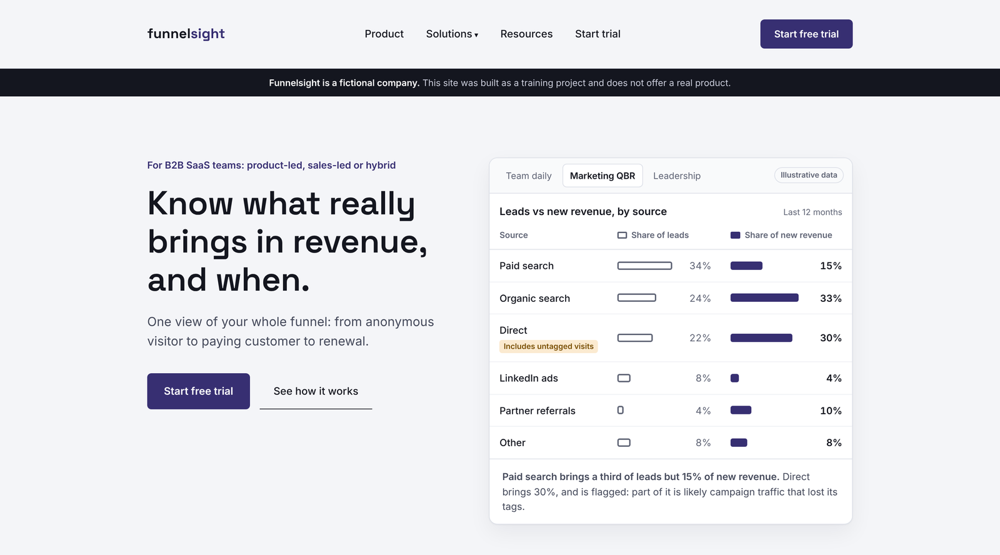
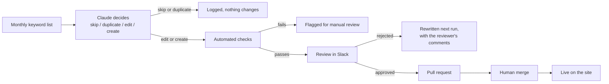
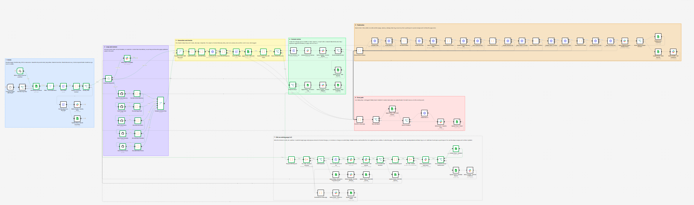
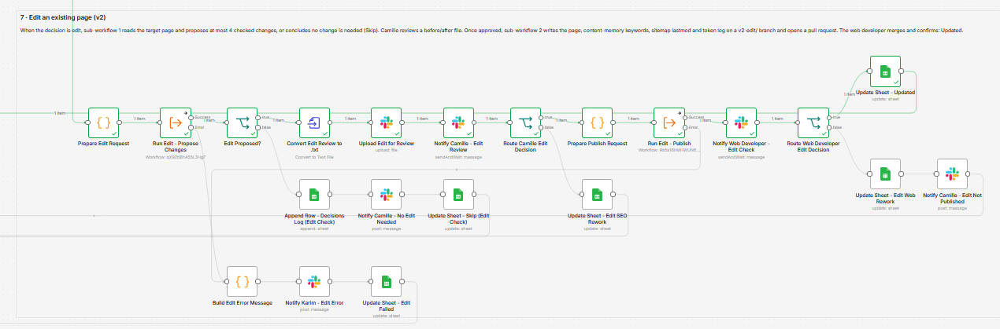

# Funnelsight


Funnelsight is a fictional growth analytics platform for B2B marketing and revenue teams. The company and its product are invented. The work behind the site is real.

I built it as the practical half of a certification project (RS7424, AI-driven transformation of work processes). The goal was to use AI to change how a piece of marketing work gets done, beyond writing text faster.

**Live site:** [funnelsight.dev](https://funnelsight.dev)



## In 30 seconds

- **What it is:** a demo SaaS site whose SEO pages are produced by an AI workflow. A person approves every page before it goes live.
- **What changed in the work:** the SEO specialist no longer writes pages. They choose the keywords and review what comes out.
- **What I designed:** the process, the editorial and brand rules, the quality checks, and what stays manual. Beyond writing the pages, Claude was my working partner on the engineering side throughout the project, from the workflow logic to the site code.
- **How it's measured:** a monthly report puts what each page cost next to what it earned in search.

## The problem

In most small marketing teams, SEO content has no owner. Pages get written by whoever has an hour free, with no shared template and no common quality bar.

Each page can be fine on its own, but they don't match. And when tone and structure change from one page to the next, nobody can tell why one page underperforms.

## What changed in the work

| | Before | After |
|---|---|---|
| **Who writes** | Whoever has time | Claude, from shared rules and templates |
| **The SEO specialist** | Writes pages | Picks keywords, reviews every page |
| **Quality bar** | Depends on the writer | Same rules and checks for every page |
| **Duplicate pages** | Spotted later, if ever | Checked before anything is written |
| **Cost per page** | Unknown | Logged for every call |

## How it works

Once a month, the workflow takes a list of keywords and handles them one at a time.

1. **Decide.** For each keyword, Claude chooses between four answers: skip it, flag it as a duplicate, improve an existing page, or create a new one.
2. **Write.** For a new page, Claude writes it. For an improvement, a second call reads the page as it's published and proposes up to four targeted changes.
3. **Check.** The workflow checks the output automatically: valid address, no broken links, no leftover template text.
4. **Review.** The page goes to Slack for a person to approve or send back with comments.
5. **Publish.** Once approved, everything ships in a single pull request, and a person merges it.



The actual n8n workflow, for scale:



<details>
<summary>What each zone of the workflow does</summary>

| Zone | What happens there |
|---|---|
| 1 · Intake (blue) | Monthly trigger or manual run. Reads the keyword sheet and checks required fields. |
| 2 · Loop and context (purple) | One keyword at a time. Re-reads the reference files from GitHub at each iteration. |
| 3 · Generation and checks (yellow) | One Claude call per keyword, output checks, cost logging. |
| 4 · Content review (green) | Slack review of the full page. Skip and duplicate decisions are logged. |
| 5 · Publication (orange) | Five files written to a branch one after another, pull request, human merge. |
| 6 · Error path (red) | Cost logged, branch cleaned up, alert, row marked Failed, batch continues. |
| 7 · Page edits (grey) | Second Claude call on the target page, change checks, before/after review, pull request. |



</details>

## What stays human

Claude never publishes anything. A person decides at two points.

**Before anything is written to the site,** every new page or edit goes to Slack for review. A rejected page goes back with the reviewer's comments, and the next draft starts from them.


**Before anything goes live,** a person merges the pull request. That step is a real review. On the first edit that went live, I rewrote one redundant sentence by hand before merging. The checks catch what would break a page. Whether a sentence earns its place is still a human call.


The main branch is protected: nothing can be pushed to the live site without a pull request, not even with an admin account.

## Better pages, not more pages

As the site grew, new pages started to look alike. A site full of close variations competes with itself in search and gives readers little new. So before writing anything, the workflow asks whether an existing page could answer the keyword better. Creating a new page comes last.

The same idea guided a hand review of the whole site. With Claude, I went back over the generated pages to shorten sentences, explain finance terms in plain words, check that every example and figure is realistic, and align titles with what people actually search, based on Google's Keyword Planner. Some pages were rewritten, one was merged into another and removed. A few pages were written by hand from the start: the product page, the solution pages and the [about page](https://funnelsight.dev/about).

## Measuring it

A second workflow closes the loop once a month. Search Console says what each page earned. Only the workflow knows what it cost to make. The report puts both side by side, then Claude drafts a short note: three points for leadership, a status for each page (Protect, Refresh or Too early) and a few actions for the month.

Code computes, the model writes. Code decides which status each page can get, and a note that breaks those rules is rejected before it's saved. The note stays a draft until the SEO specialist reviews it.

Cost was a design constraint from the start: a model chosen for the balance between writing quality and price, capped responses, cached reference files and a spending cap on the account. Letting code build what Claude used to rewrite in full roughly halved the cost of a page.

## What I learned along the way

Several rules came from real failures or from the data, not from the first design:

- **Duplicates hide in what a page lets you do.** An early check compared keywords and intent only, and let through a page that restated an existing feature from another angle. It now also compares what each page would let a reader do.
- **A cut-off response is never published.** The keyword is flagged for manual review instead of being retried.
- **One failure doesn't stop the batch.** The keyword is marked Failed, its cost logged, its branch deleted, an alert sent, and the next keyword starts.
- **Your own clicks distort the data.** A click from France can be the team checking its own pages, so a page needs at least one click from outside France to be marked Protect.
- **Search data beats intuition.** Some topics that come up constantly in conversations are almost never typed into Google, while others are searched under a different name. Titles now follow the words people use.

The reasoning behind the main technical choices, and the trade-offs I'd reconsider if the project grew, is in [`docs/architecture-decisions.md`](docs/architecture-decisions.md).

<details>
<summary>Under the hood: site structure, stack and privacy</summary>

### Site structure

```
/                           homepage
/product                    product page (hand-written)
/about                      about the author (hand-written)
/trial                      trial signup page (disabled)
/resources                  guides and articles hub
/playbooks/                 use-case SEO pages
/features/                  product feature SEO pages
/glossary/                  educational SEO pages
/case-studies/              illustrative case study SEO pages
/solutions/                 audience pages (hand-written, outside the automated flow)
/404.html                   error page
/styles.css                 single site-wide stylesheet
/fonts/                     self-hosted fonts (Inter, Space Grotesk) and their licenses
/assets/                    images for this README and the site
/sitemap.xml                sitemap submitted to Google Search Console
/content-memory.md          reference memory used to avoid duplicates and keep internal links consistent
/token-usage-log.md         API token use, one line per published page or edit
```

### Stack

Static site, plain HTML and CSS, no framework and no build step, deployed on Cloudflare Pages. The workflows run on n8n and call the Claude API.

The prompts, page templates and product facts the workflows read live in a separate private repository. Every prompt change is first run on a fixed set of keywords whose right answer is already known, so a regression shows up before a real run.

### Privacy

Google Analytics only loads after a visitor accepts it in the consent banner. Until then, no request reaches Google, and fonts are self-hosted for the same reason. A "Cookie settings" link in the footer reopens the banner, and withdrawing consent clears the analytics cookies. The banner, Google Analytics and click tracking on calls to action share one script, `/assets/site.js`, so every page behaves the same way.

Search Console access is read-only, and Claude only receives aggregated metrics per page, never data about individual visitors.

</details>
